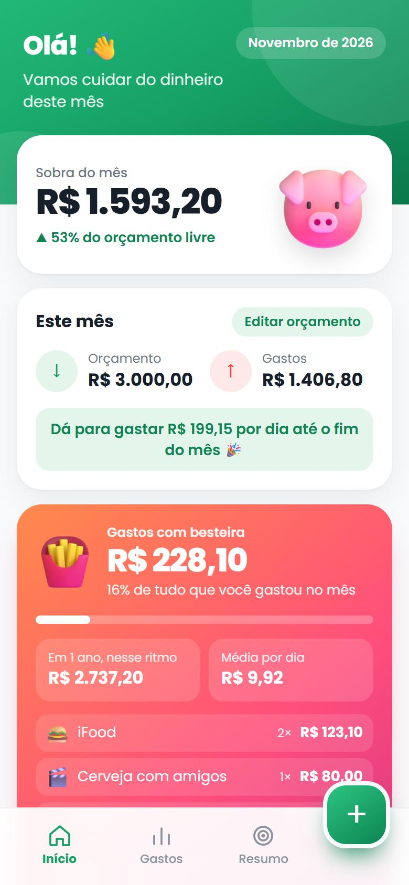
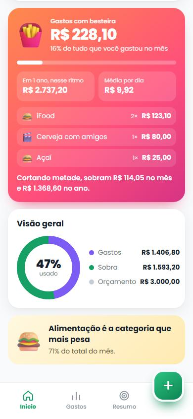
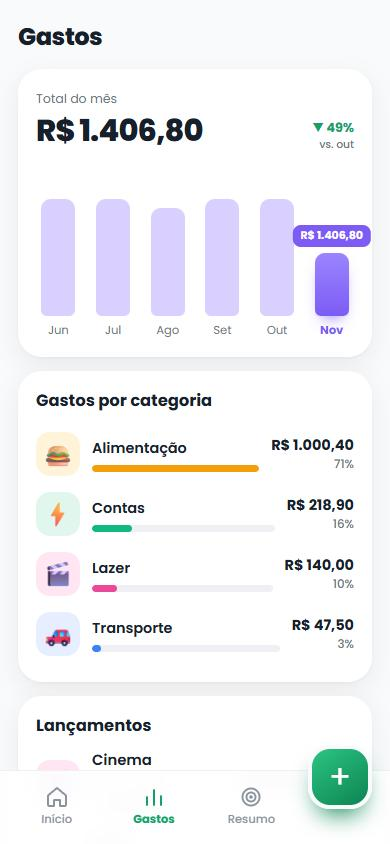

# 🐷 Controle de Gastos

**Orçamento do mês, gráficos e um medidor de quanto vai embora em besteira.**

&nbsp;&nbsp;
&nbsp;&nbsp;

## O que ele faz

- **Sobra do mês.** Você define o orçamento e vê quanto ainda pode gastar, inclusive por dia, até o mês acabar.
- **Gastos com besteira 🍟.** Marque os gastos que dava para evitar. O app sugere sozinho para iFood, lanche, cerveja, açaí… e mostra:
  - quanto foi no mês e quanto isso vira em **1 ano**;
  - as besteiras que mais se repetem;
  - quanto sobraria cortando metade.
- **Gráficos.** Rosca do orçamento, barras dos últimos 6 meses e comparação com o mês anterior.
- **Categorias.** Alimentação, Transporte, Lazer, Contas e Outros, cada uma com cor, ícone e porcentagem.
- **Resumo do mês.** Situação do orçamento e dicas concretas de economia, com o valor que dá para poupar.
- **Registro rápido.** O botão **+** abre uma gaveta com valor, descrição e categoria.

## Como usar

Abra **https://rico2978bg-hub.github.io/controle-gastos/** no celular ou no computador. No celular, dá para usar "Adicionar à tela inicial" e abrir como um app.

Para rodar localmente, basta abrir o `index.html` no navegador. Não precisa instalar nada.

## Detalhes

- Tudo fica em um único arquivo (`index.html`), com HTML, CSS e JavaScript puros.
- Os valores são guardados em centavos, para a soma não ter erro de arredondamento. Só os gastos do mês atual entram no total do mês.
- Os dados ficam salvos só no seu navegador (`localStorage`). Nada é enviado para servidor nenhum.
- Ícones: [Fluent Emoji 3D](https://github.com/microsoft/fluentui-emoji), da Microsoft (licença MIT). Sem internet, o app usa os emojis comuns do sistema.
